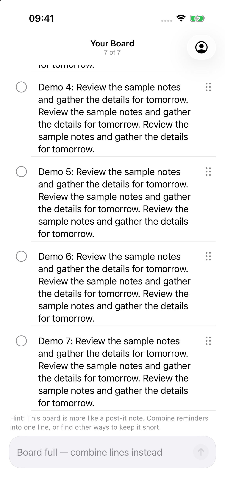
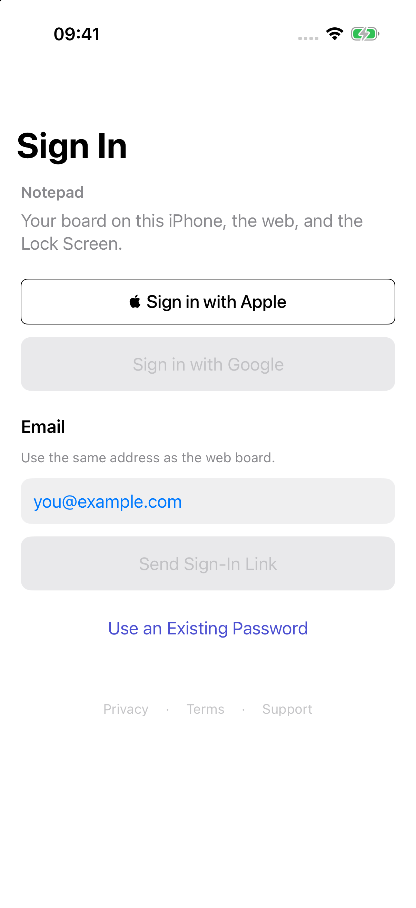
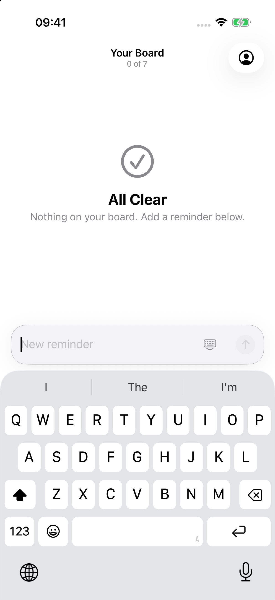

# Notepad UI hill climb: progress report

Work continues on `hillclimb/ui`. Final score gate has not been reached. Round3 runtime checks pass and independent Codex grading is running. Opus runs only when both Codex overall grades reach8.5 in the same round. Stop requires all three>=9, with no category below7.

## Category scores

| Category | R1 Sol | R2 Sol | R1 Astra | R2 Astra |
| --- | ---: | ---: | ---: | ---: |
| Visual hierarchy | 7.5 | 8.5 | 7 | 8.5 |
| Spacing/grid | 7.0 | 8.0 | 7 | 8.2 |
| Typography scale | 8.5 | 8.5 | 8 | 8.5 |
| Dynamic Type | 7.5 | 7.8 | 7 | 8.0 |
| Light contrast | 7.0 | 8.2 | 7 | 8.3 |
| Dark contrast | 6.5 | 8.3 | 6.5 | 8.3 |
| Iconography | 8.0 | 8.4 | 8 | 8.5 |
| Safe area / Dynamic Island | 8.0 | 8.0 | 8 | 8.5 |
| Scroll/pull-down / last row | 4.0 | 9.0 | 4 | 9.2 |
| List rows | 6.5 | 7.5 | 6.5 | 7.8 |
| Empty states | 7.0 | 8.0 | 7.5 | 8.2 |
| Composer ergonomics | 6.0 | 8.2 | 6 | 8.6 |
| Keyboard handling | 7.0 | 7.0 | 7.5 | 7.2 |
| Sheet presentation/detents | 7.0 | 9.0 | 6 | 9.0 |
| Navigation clarity | 7.5 | 8.5 | 7 | 8.7 |
| Touch targets | 4.5 | 9.0 | 4.5 | 9.0 |
| Haptics | 7.0 | 7.5 | 7 | 7.0 |
| Animation/transitions | 6.5 | 7.5 | 6.5 | 7.4 |
| Loading states | 7.5 | 7.5 | 7 | 7.6 |
| Error states | 7.5 | 7.8 | 7 | 7.5 |
| VoiceOver/labels | 7.5 | 7.8 | 7.5 | 7.5 |
| iOS HIG consistency | 7.5 | 8.4 | 7 | 8.5 |
| Lock Screen / Live Activity | 6.0 | 7.7 | 6 | 8.0 |
| Sign-in/onboarding | 6.5 | 8.0 | 6.5 | 7.8 |
| Settings/account | 7.0 | 8.7 | 6 | 8.5 |
| Performance feel | 6.5 | 7.5 | 6.5 | 7.6 |
| Delight | 6.5 | 7.4 | 6.5 | 7.5 |
| Long text | 7.0 | 8.4 | 7 | 8.3 |
| Reduced Motion / Transparency | 7.0 | 8.0 | 6 | 8.0 |
| Palette / minimalism | 7.0 | 9.2 | 7 | 9.0 |

Round3 scores pending. No Opus result is claimed. [Machine-readable scores](rounds/2/scores.json).

## Current verification

Production source `6959de1`; test correction `542b9f7`. All276 tests passed:260 unit+16 UI. Three additional fresh-process keyboard matrices passed all24 cases; combined run adds8. Test now supports valid interactive keyboard dismissal and refocus before checking keyboard geometry. Original275-pass/1-failure evidence stays intact. No assertions or normal dismissal behavior were disabled.

Fresh unsigned arm64 Debug/Release builds,23 Python iOS checks and52+4 offline Deno tests passed. Recheck rebuilt Debug; Release/backend results were explicitly reused after53 production+11 backend hashes matched. Zero observed runtime warnings/invalid-frame events in complete recheck runs; other compiler/automation diagnostics remain. [Recheck](validation/round3/recheck/REPORT.md).

## Screenshots and Apple references

Round1 has18 native baseline images; round2 has48; round3 has110 (102 original plus8 post-scroll keyboard rechecks). Every grading image has device/source/hash provenance on the original regular iPhone17Pro/iOS26.2. Round3 adds8 actual XXXL Apple Reminders references for list, bottom, compose and Details in both appearances. Pairings exclude rejected transition frames and disclose imperfect matches. Notes, Apple sign-in and exact Activity equivalents remain unavailable. [Round3 inventory](rounds/3/inventory.json) · [Reference pairings](rounds/3/pairings.md).

| State | Before: round1 | Current: round3 |
| --- | --- | --- |
| Final row after pull |  |  |
| Sign-in surfaces |  |  |
| Account initial sheet |  |  |
| Composer keyboard |  |  |

Native Activity has no round1 native baseline, so no baseline pair is invented. Expanded Island evidence uses unmodified recording frames; Notification Center banners do not certify actual locked-device geometry. Unit-rendered attachments are separate from native captures.

## Merged changes

- Capture harness: repeatable offline demo fixtures, geometry/pixel checks, screenshot scripts, Apple-reference pairings and score validator.
- Board reading (`cc98098`, `ef82a67`): removed final-ink fades, fixed refresh cleanup and compact title behavior, measured44pt controls.
- Activity polish (`dcc4200`): scalable type, native surface budgets and lower-corner footer clearance.
- Sign-in surfaces (`04098b7`): flat outer surfaces,44pt field focus containers and keyboard scrolling.
- Account (`9f94f55`): opaque grouped sheet, large on open/reopen, medium retained, accessible Done and safe demo scrolling.
- Activity overflow (`970f567`, `3020d31`): preserves original line totals across payload/surface caps; five visible+five hidden becomes three visible+seven hidden. Optional metadata retains legacy lines encoding. Backend preparation is committed but undeployed; previously summarized remote payloads cannot recover lost totals.
- Keyboard recovery (`3993113`): replaces invalid-frame keyboard-toolbar path with a layout-participating48pt Done inset, separated alternate action, safe local demo editing, exact-text error announcement deduplication.
- Board multiline (`d9fa416`, `8e384d0`, `1add78a`): first-line control alignment, semantic contrast, intrinsic-height static capacity copy, flat guide hidden during composing, exact-text error announcements and44pt retry.
- Test correction (`542b9f7`): confines form scrolling above the keyboard and verifies dismissal/refocus before geometry checks.

Individual task counts and retained intermediate failures are in [task evidence](tasks). Current integrated276-test pass supersedes worker-only totals. All merges stay on `hillclimb/ui`; main, deployment, uploads and force pushes remain untouched. Existing user untracked files are preserved.

## Remaining limits

True device locking, physical cutout geometry, arbitrary wallpapers, tactile haptics, spoken VoiceOver, accessibility sizes beyondXXXL, broader system contrast/motion/transparency settings and measured motion/performance remain unverified. Source/tests support only the claims recorded with them. Current-session quota metadata reports9% used in the10080-minute weekly window; [snapshot](rounds/3/usage.json). No plateau decision before fresh grades.

## Install on a phone

1. Check out `hillclimb/ui`. Generate `ios/LazyMansReminders.xcodeproj` using the existing XcodeGen workflow and your private development `Config.xcconfig`.
2. In Xcode select your development team and a connected, trusted iPhone with Developer Mode enabled. Select the app scheme, then Build and Run.
3. Use the normal account build for real sign-in/notifications. Screenshot setup uses the isolated `systems.edmundlim.NotepadHillclimb` demo bundle/group; its offline data is synthetic.

No App Store/TestFlight upload or deployment is authorized. Physical sign-in, persistence, notifications and haptics need phone verification.

Written by gpt-6.1-sol in Codex on behalf of Edmund
