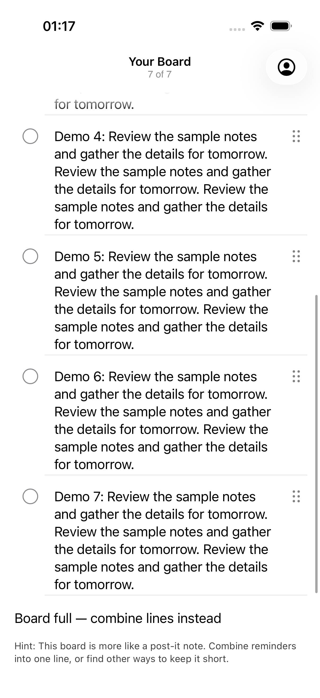
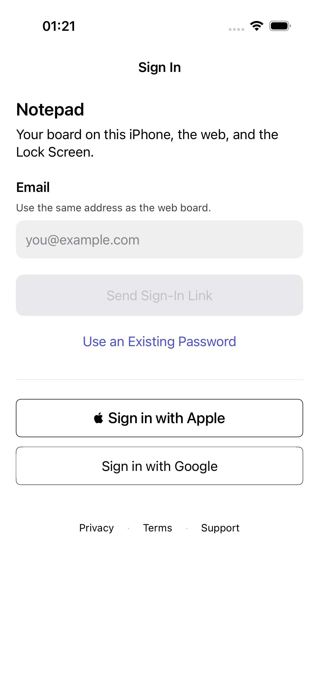
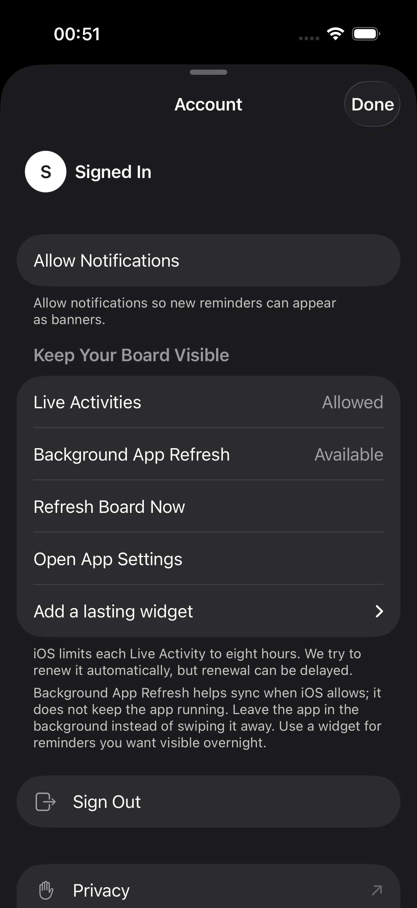
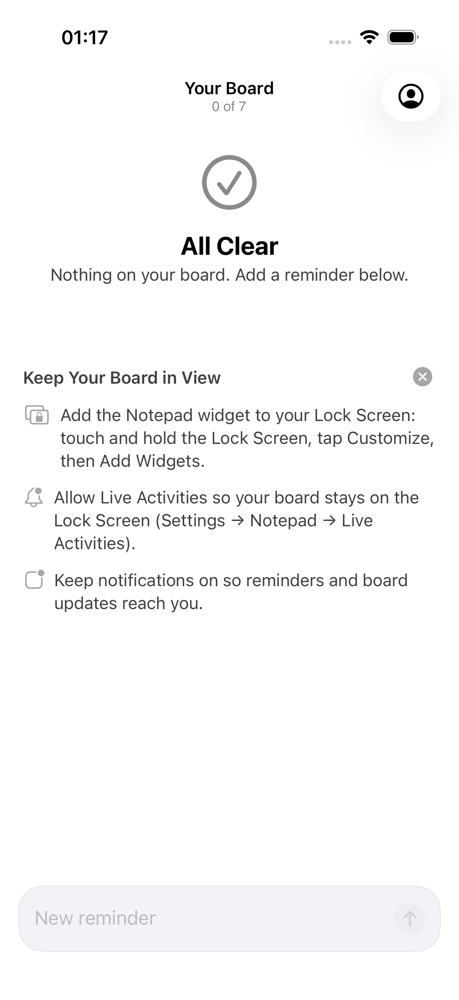

# Notepad UI hill climb report

The verified build is merged and pushed on `hillclimb/ui`. Latest grades are **Sol 8.57/minimum 7.5** and **Astra 8.40/minimum 7.3**. Latest Opus remains **8.69/minimum 7.8 from round 5**; round 8 is ineligible because Astra is below 8.5. No Claude API or Cursor tokens were used this round. **The all-three 9/10 target is not met.**

This run stops under the requested three-round plateau rule. I apply that as three completed rounds without a new best overall from either Codex grader: rounds 6–8 did not exceed round 5's Sol 9.06/Astra 9.15. Scores varied rather than staying numerically flat. Coverage and reviewer judgment also changed, so this is lack of sustained measured gain, not proof that every unchanged screen regressed. [The machine-readable audit](rounds/8/plateau-audit.json) makes that interpretation explicit. This is not a quota stop; the final observed weekly usage is 38.0%.

The remaining blocker is the login's composition: too many similarly weighted horizontal bands, a strong native Apple asset competing with the selected credential path, and partial provider controls at the keyboard boundary. Loading footprint, field/heading clearance and Account instruction emphasis improved, but those measurable fixes did not establish the calm native appearance Edmund wants. No further ungraded source changes were made after the reviews.

## Start and final category scores

| Category | R1 Sol | R8 Sol | R1 Astra | R8 Astra | R3 Opus | R5 Opus |
| --- | ---: | ---: | ---: | ---: | ---: | ---: |
| Visual hierarchy | 7.5 | 7.9 | 7 | 7.6 | 8.5 | 8.9 |
| Spacing/grid | 7 | 8.1 | 7 | 7.8 | 8.3 | 8.8 |
| Typography scale | 8.5 | 8.7 | 8 | 8.5 | 8.2 | 8.8 |
| Dynamic Type | 7.5 | 8.6 | 7 | 8.5 | 8.6 | 8.8 |
| Light contrast | 7 | 9 | 7 | 8.7 | 8.4 | 8.9 |
| Dark contrast | 6.5 | 8.8 | 6.5 | 8.6 | 8 | 8.9 |
| Iconography | 8 | 9 | 8 | 9 | 8.6 | 8.8 |
| Safe area / Dynamic Island | 8 | 9.1 | 8 | 9 | 8.8 | 8.9 |
| Scroll/pull-down / last row | 4 | 8.5 | 4 | 9 | 8.4 | 8.9 |
| List rows | 6.5 | 8.8 | 6.5 | 8.7 | 7.8 | 8.9 |
| Empty states | 7 | 8.7 | 7.5 | 8.3 | 8.8 | 8.9 |
| Composer ergonomics | 6 | 9 | 6 | 8.9 | 8.6 | 8.7 |
| Keyboard handling | 7 | 8.4 | 7.5 | 8.2 | 8.5 | 8.8 |
| Sheet presentation/detents | 7 | 8.9 | 6 | 8.9 | 8.5 | 8.7 |
| Navigation clarity | 7.5 | 8.7 | 7 | 8.8 | 8.7 | 8.9 |
| Touch targets | 4.5 | 9.2 | 4.5 | 9 | 8.4 | 9.1 |
| Haptics | 7 | 7.8 | 7 | 7.5 | 7.5 | 7.8 |
| Animation/transitions | 6.5 | 8 | 6.5 | 7.8 | 7.6 | 8.2 |
| Loading states | 7.5 | 9 | 7 | 8.1 | 8.5 | 8.7 |
| Error states | 7.5 | 8.5 | 7 | 8.8 | 7.6 | 8.7 |
| VoiceOver/labels | 7.5 | 8.4 | 7.5 | 8 | 8.2 | 8.6 |
| iOS HIG consistency | 7.5 | 8.6 | 7 | 8.4 | 8.1 | 8.8 |
| Lock Screen / Live Activity | 6 | 8.7 | 6 | 8.3 | 7.8 | 8.1 |
| Sign-in/onboarding | 6.5 | 7.5 | 6.5 | 7.3 | 8 | 8.8 |
| Settings/account | 7 | 8.8 | 6 | 8.2 | 8.1 | 8.7 |
| Performance feel | 6.5 | 8.2 | 6.5 | 8 | 7.6 | 7.9 |
| Delight | 6.5 | 7.8 | 6.5 | 7.7 | 7.8 | 8.1 |
| Long text | 7 | 8.9 | 7 | 9 | 8.7 | 8.8 |
| Reduced Motion / Transparency | 7 | 8.7 | 6 | 8.7 | 8 | 8.7 |
| Palette / minimalism | 7 | 8.9 | 7 | 8.8 | 9 | 9.1 |

Overall start→final:Sol 6.88→8.57, Astra 6.70→8.40; Opus 8.25 (round 3)→8.69 (round 5).

Opus columns use its first and latest actual reviews; missing rounds are not inferred. Every report has the exact30categories. [round 8 aggregate](rounds/8/scores.json), [Sol review](rounds/8/scores-gpt-6.1-sol.md), [Astra review](rounds/8/scores-gpt-6-astra.md) and [score history](score-progress.html) retain the actual values.

## Final changes and checks

Graded app/test source: `20ae77e29019444a499e9e47c98d6b656ef56819`. Production source: `46c1a5b7ebd9ad29be3f2ffb754b8e8f347c45b4`. Source identity: `sha256:a2449d961c428fc781cea0c751f3406e3e0e499350000d32bc4eca2fbfa0d76f`. Verified integration merge: `4783ce10396f5bab467b22f6479d515ab89b94de`; final reporting metadata is committed separately. All work stays on `hillclimb/ui`.

- **325/325 passed: 263 unit+ 62 UI,zero failures/skips.** All 317 prior named IDs and transitive308/307/304/293baselines remain. All 94 tracked+2 generated inputs match. Serial generated arm64 xctestrun uses original17, diagnosticsnever and unchanged240/300 second limits.
- Fresh unsigned Debug/Release, Python 23 and cached Deno 52+4 passed. Debug artifacts were restored byte for byte; all six installed app/widget executables match. All five Settings-changing methods independently started/restored the actual four originals0/1/0/0.
- Only SignInView and BoardPersistenceSection change production in this pass: contiguous credentials before secondary Apple/Google; quieter Google outline; non-sizing native loading overlay; measured heading/field focus settlement; semibold existing Home Screen:/Lock Screen: prefixes. Every original word, native Apple asset, provider order, authentication guard, icon and branding remains.
- **332 canonical native images**,522 indexed acquisitions,16 movie excerpts,60 matched login pairs and17 Apple references. Twelve unit rasters are separate. Protected secure-keyboard stills are labeled partial;16 complete keyboard movie frames and8 unmodified 2sIsland frames supplement them. Both reviewers checked hashes and actual native pictures; duplicate acquisitions do not earn extra score credit.
- Historical322/2synthetic-heading failures and323/1keyboard timeout remain failed. The latter bypassed Settings teardown; explicit native recovery restored captured originals. Test-only corrections use actual heading geometry and split the same eight keyboard configurations by appearance without dropping assertions or increasing timeouts. The final unfiltered pass stands independently. [Validation and failure details](validation/round8/README.md).

## Before and after

| State | Initial baseline | Final round 8 |
| --- | --- | --- |
| Final row after pull |  |  |
| Default login |  |  |
| Account initial sheet |  |  |
| Composer |  |  |

Initial login providers are disabled; the final enabled-looking fixture is inert, so colors differ in that respect. Account now opens large rather than the earlier medium presentation. [Sixty exact R7/R8 login pairs](validation/round8/login-pairings.json) and [paired sheets](rounds/8/login-pairs/page-01.jpg) provide closer same-state composition comparisons. New filled-pending fixtures have no exact R7 pending counterpart. Native Activity has no actual round 1 baseline.

[Reference pairs](validation/round8/reference-pairings.json) use all 17 actual Reminders originals. Notes and exact authentication, Activity, capacity, medium-detent and combined-settings counterparts are unavailable; closest matches and gaps are explicit.

## Merged changes

- Offline demo fixtures and repeatable capture scripts; native geometry/pixel/contrast gates, reference pairings and score validation.
- Board: removed final-ink fade, repaired refresh settling and safe insets, aligned multiline rows, 44pt completion/grip controls, circle-only completion, persistent draft Done, accessible error/retry and one VoiceOver completion stop. Top boundary fades only after scrolling; accessibility configurations use an opaque edge.
- Capacity: remove inactive Add at full capacity, preserve wrapping/status wording, place status before help with one 18pt gutter and 6pt gap, reduce footer 16pt while keeping final ink visible.
- Live Activity: scalable layouts and corner clearance, conserved visible/hidden counts through local state/payload/surface caps, native Island-only tightening. Short XXXL lines now finish words; long native ellipses remain. Backend preparation is committed but undeployed.
- Sign-in: flattened surfaces; replaced invalid-frame toolbar path with 48pt layout-participating Done; persistent Password label and native hard top edge; official visible Apple button, safe inert provider/legal fixtures, readable errors and exact-message announcement deduplication.
- Login composition: inline Sign In, title2 Notepad, coherent neutral outlined providers, 48pt filled fields, 8pt within/20pt between groups and 24pt provider boundary, quieter helper text and contrast-checked enabled submit. Empty/invalid submit remains disabled. Authentication/provider order and all wording stay fixed.
- Account: opaque native grouped sheet, large on open/reopen with medium retained, reachable 44pt Done, aligned body-sized actions/icons, exact guidance in two 6pt-spaced paragraphs, native 35pt section boundaries, passive identity without extra chrome and readable quieter helpers.
- Regression evidence includes genuine failed attempts, concrete test-contract corrections, exact named-test retention, settings restoration, source/binary/image hashes and honest protected-screen/reference limitations.

Task histories and exact commits are in `tasks/`, `decisions.md` and Git history. All accepted changes stay on `hillclimb/ui`; main, deployment, App Store/TestFlight and force pushes remain untouched. User untracked files remain unchanged.

## Why the climb stopped and what remains

Rounds 6–8 have not improved either Codex grader's previous best overall. Small fixes now improve measured correctness without resolving the full login hierarchy. Both final reviewers independently flag the same competing bands and provider boundary; their Sign-in/onboarding scores remain 7.5 and 7.3. The next design direction would need a stronger composition decision, evaluated as a whole, rather than more isolated gap changes. The plateau stop preserves these findings instead of manufacturing 9/10 scores.

Unmerged future findings are retained in the two final reports: make the alternate-method treatment quieter, avoid a provider being sliced by Done at automatic settlement, associate credential errors with their action, strengthen pending-spinner prominence, improve expanded guidance scanning and tune the board's faint upper fragments. Their proposed measurable checks are recorded; none is claimed implemented or passing as a new fix.

True locked-phone geometry/wallpapers, physical haptics, spoken VoiceOver, AX1–AX5, live authentication/account/AutoFill and hardware frame pacing remain unobserved. Five actual simulator samples each yielded launch 0.987769±0.043757 s, scroll protocol 4.793953±0.156057 s and scrolling signpost 2.347497±0.007918 s. These include host/XCTest behavior and establish neither hardware feel nor improvement.

Edmund explicitly retained existing raw network-error wording. Original17 remains running light/Large with the four switches restored, no owned demo Activities and only the parent's own panel closed. No deployment, App Store/TestFlight upload, PR, main merge or force push occurred. Original user untracked files remain untouched.

Repository maintenance incident: 26 unrelated detached automatic pack jobs filled the disk and exited before the stop attempt. 27 temporary outputs totaling 6.62 GiB remain preserved; no Git objects/pack files were deleted, reset or repacked by PM. Repository-only `gc.auto=0` and `maintenance.auto=false` prevent a repeat; original absent values are recorded in [the recovery record](validation/round8/automatic-maintenance-recovery.json). This is not a global Git setting. Disk space remains limited. The temporary Mac keep-awake assertion will be removed after final report synchronization, with its exact process identity checked.

## Install on a phone

1. Check out `hillclimb/ui`; follow the repository’s existing XcodeGen setup with your private development `ios/Config.xcconfig` to generate the Xcode project.
2. Open `ios/LazyMansReminders.xcodeproj` in Xcode, select your development team and a connected, trusted iPhone with Developer Mode enabled, then select the app scheme and Build and Run.
3. Use the normal account build for real sign-in/notifications. Screenshot setup uses isolated `systems.edmundlim.NotepadHillclimb` demo bundle/group and synthetic offline data. Simulator builds do not install directly onto a physical phone.

No TestFlight/App Store upload or deployment is authorized. Phone sign-in, persistence, notifications and tactile behavior still need physical verification.

Written by gpt-6.1-sol in Codex on behalf of Edmund
