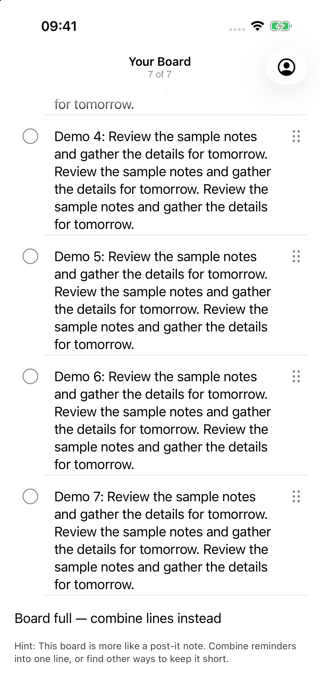
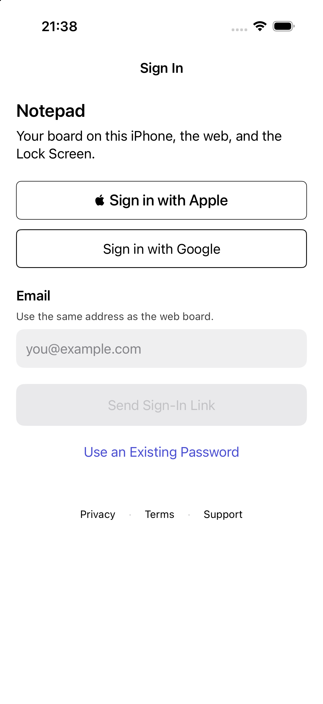
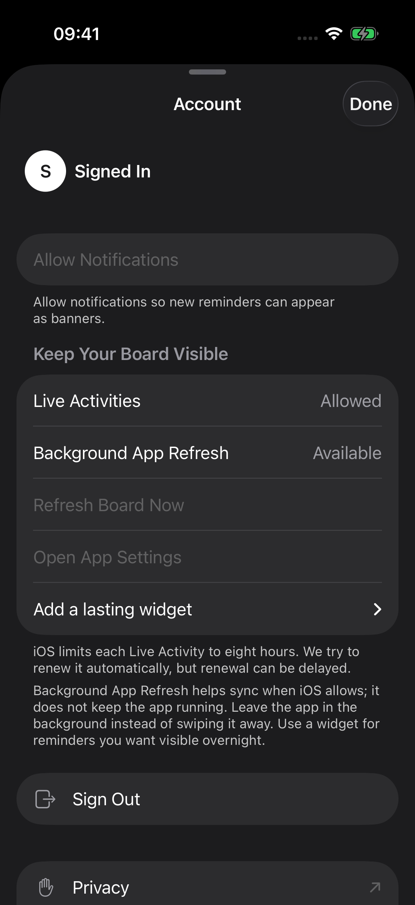
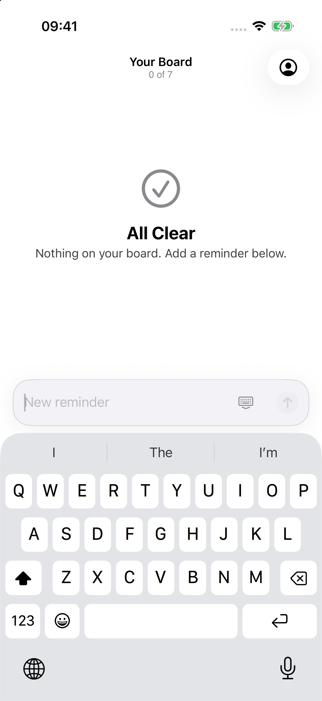

# Notepad UI hill climb: progress report

The verified combined login and density improvements are merged into `hillclimb/ui`. **Round7 passed317/317 tests**; independent ratings are **Sol8.50/minimum7 and Astra8.13/minimum7**. Latest Opus is Round5 8.69/minimum7.8. Round7Opus is ineligible because Astra<8.5. Round6 Opus was deferred to conserve Claude tokens while addressing Edmund’s login/crowding feedback. The final all-three>=9/minimum7 goal remains unmet. Both graders see a clearer default login but still flag hierarchy, loading reflow and first-focus polish. The next bounded PM pass addresses those findings; the lower aggregate is retained, without claiming a regression in every unchanged category.

## Start and latest completed category scores

| Category | R1 Sol | R7 Sol | R1 Astra | R7 Astra | R3 Opus | R5 Opus |
| --- | ---: | ---: | ---: | ---: | ---: | ---: |
| Visual hierarchy | 7.5 | 8.2 | 7 | 8 | 8.5 | 8.9 |
| Spacing/grid | 7.0 | 8.6 | 7 | 8 | 8.3 | 8.8 |
| Typography scale | 8.5 | 8.5 | 8 | 8.5 | 8.2 | 8.8 |
| Dynamic Type | 7.5 | 8.8 | 7 | 8 | 8.6 | 8.8 |
| Light contrast | 7.0 | 9 | 7 | 8.5 | 8.4 | 8.9 |
| Dark contrast | 6.5 | 9 | 6.5 | 8.5 | 8.0 | 8.9 |
| Iconography | 8.0 | 8.8 | 8 | 8.5 | 8.6 | 8.8 |
| Safe area / Dynamic Island | 8.0 | 9 | 8 | 8.5 | 8.8 | 8.9 |
| Scroll/pull-down / last row | 4.0 | 9.1 | 4 | 8.5 | 8.4 | 8.9 |
| List rows | 6.5 | 8.6 | 6.5 | 8.5 | 7.8 | 8.9 |
| Empty states | 7.0 | 8.3 | 7.5 | 8 | 8.8 | 8.9 |
| Composer ergonomics | 6.0 | 8.8 | 6 | 8.5 | 8.6 | 8.7 |
| Keyboard handling | 7.0 | 8.6 | 7.5 | 7.5 | 8.5 | 8.8 |
| Sheet presentation/detents | 7.0 | 8.9 | 6 | 8.5 | 8.5 | 8.7 |
| Navigation clarity | 7.5 | 8.6 | 7 | 8.5 | 8.7 | 8.9 |
| Touch targets | 4.5 | 9.1 | 4.5 | 8.5 | 8.4 | 9.1 |
| Haptics | 7.0 | 7 | 7 | 7 | 7.5 | 7.8 |
| Animation/transitions | 6.5 | 8 | 6.5 | 7.5 | 7.6 | 8.2 |
| Loading states | 7.5 | 7.8 | 7 | 7.5 | 8.5 | 8.7 |
| Error states | 7.5 | 8.7 | 7 | 8.5 | 7.6 | 8.7 |
| VoiceOver/labels | 7.5 | 8 | 7.5 | 8 | 8.2 | 8.6 |
| iOS HIG consistency | 7.5 | 8.6 | 7 | 8 | 8.1 | 8.8 |
| Lock Screen / Live Activity | 6.0 | 8.1 | 6 | 8 | 7.8 | 8.1 |
| Sign-in/onboarding | 6.5 | 8 | 6.5 | 8 | 8.0 | 8.8 |
| Settings/account | 7.0 | 8.7 | 6 | 8 | 8.1 | 8.7 |
| Performance feel | 6.5 | 7.5 | 6.5 | 7.5 | 7.6 | 7.9 |
| Delight | 6.5 | 7.8 | 6.5 | 7.5 | 7.8 | 8.1 |
| Long text | 7.0 | 9 | 7 | 8.5 | 8.7 | 8.8 |
| Reduced Motion / Transparency | 7.0 | 8.8 | 6 | 8.5 | 8.0 | 8.7 |
| Palette / minimalism | 7.0 | 9 | 7 | 8.5 | 9.0 | 9.1 |

These columns use each grader’s actual first and latest completed round; Opus did not review rounds1–2 or6. No missing score is inferred. Full histories and machine-readable aggregates are under `rounds/`.

## Latest changes and validation

Frozen corrected source: `e9f7ace58b493dd4aa3acb27325eaea7cf0ed352`, source identity `sha256:8dbe9d6966c05a098491adb9e172fb20bf1b7edcad72d4dd9e201f2159dd2434`, integration merge `f096e2a`. All93frozen inputs match, including91tracked source inputs and2explicitly hashed generated configuration/package inputs. The pack-read issue was resolved by iCloud hydration; exact tested bytes were committed. Historical handoff blockage remains recorded.

- **317passed,0failed,0skipped:**263unit+54UI. Every308/307/304/293 prior named ID is retained. Serial unfiltered XCTest uses the exact generated arm64 Debug xctestrun on original17. Strict44pt SignInSurface checks remain unchanged; source fields now48pt. Circle comparisons allow only1e-9pt CGRect roundoff.
- Fresh Debug/Release, Python23, cached offline Deno52+4, Debug artifact restoration and six installed app/widget hash checks passed. All3Settings-changing tests individually restored Reduce Motion, Auto-Play Message Effects, Reduce Transparency and Increase Contrast.
- **808native matrix PNGs**,52separate login after originals,44matched login pairs,17Apple Reminders references and9recordings. Acquisition count is not distinct-screen count.80protected XCTest frames remain partial; clean full-device keyboard supplements are separate. Unit ImageRenderer output is never called native evidence.
- V1’s dark filled action measured2.697:1 despite passing tests, so it was rejected. Corrected V2 adds a native4.5:1 contrast regression check; measured minimum is6.29:1. All rejected/interrupted runs and earlier R/S/T failures remain available.

[Current checks](rounds/7/checks.json), [source binding](validation/round7/source-binding.json), [parent review](validation/round7/PARENT-REVIEW.md), [full validation](validation/round7/README.md), and [login handoff](tasks/login-composition/README.md) explain the source/acquisition identities and historical flags. Parent inspected default login before/after and accepts it for independent grading; this is not Edmund’s visual acceptance or a9/10 claim.

## Before and after

| State | Initial baseline | Current round7 |
| --- | --- | --- |
| Final row after pull |  |  |
| Default login |  |  |
| Account initial sheet |  |  |
| Composer keyboard |  |  |

The initial offline login disables providers; current enabled-style login is an inert paint fixture. Compare layout with that semantic difference in mind. [44same-state login pairs](tasks/login-composition/login-pairings.json) use the frozen S grouping-only binary on original17 as the immediate before witness; [paired sheets](tasks/login-composition/paired-contact-sheets/page-01.jpg) expose the composition change. Eight new filled-enabled previews have no exact S counterpart. An additional ordinary fully-filled supplement stopped after driver failures with0frames; no matched pair was fabricated.

Apple comparison uses17usable Reminders screenshots, including default/XXXL lists, bottom, compose and Details in both appearances. Notes is unavailable; exact sign-in, Activity, capacity, medium-sheet and combined-settings references do not exist in this packet. [Reference coverage](validation/round7/reference-coverage.json) discloses each closest match and gap. Native Activity has no round1native baseline; Notification Center and expanded recording frames do not establish a truly locked phone.

## Merged changes

- Offline demo fixtures and repeatable capture scripts; native geometry/pixel/contrast gates, reference pairings and score validation.
- Board: removed final-ink fade, repaired refresh settling and safe insets, aligned multiline rows,44pt completion/grip controls, circle-only completion, persistent draft Done, accessible error/retry and one VoiceOver completion stop. Top boundary fades only after scrolling; accessibility configurations use an opaque edge.
- Capacity: remove inactive Add at full capacity, preserve wrapping/status wording, place status before help with one18pt gutter and6pt gap, reduce footer16pt while keeping final ink visible.
- Live Activity: scalable layouts and corner clearance, conserved visible/hidden counts through local state/payload/surface caps, native Island-only tightening. Short XXXL lines now finish words; long native ellipses remain. Backend preparation is committed but undeployed.
- Sign-in: flattened surfaces; replaced invalid-frame toolbar path with48pt layout-participating Done; persistent Password label and native hard top edge; official visible Apple button, safe inert provider/legal fixtures, readable errors and exact-message announcement deduplication.
- Login composition: inline Sign In, title2Notepad, coherent neutral outlined providers,48pt filled fields,8pt within/20pt between groups and24pt provider boundary, quieter helper text and contrast-checked enabled submit. Empty/invalid submit remains disabled. Authentication/provider order and all wording stay fixed.
- Account: opaque native grouped sheet, large on open/reopen with medium retained, reachable44pt Done, aligned body-sized actions/icons, exact guidance in two6pt-spaced paragraphs, native35pt section boundaries, passive identity without extra chrome and readable quieter helpers.
- Regression evidence includes genuine failed attempts, concrete test-contract corrections, exact named-test retention, settings restoration, source/binary/image hashes and honest protected-screen/reference limitations.

Task histories and exact commits are in `tasks/`, `decisions.md` and Git history. All accepted changes stay on `hillclimb/ui`; main, deployment, App Store/TestFlight and force pushes remain untouched. User untracked files remain unchanged.

## Remaining limits and next step

Independent round7 Sol/high and Astra/high reviews validate at8.50/8.13. Opus5.5/medium is skipped because Astra<8.5; the authorized Cursor fallback remains available only if API tokens run out on an eligible round. Final stop requires all3>=9 with no category<7 and real regression gates passing.33% of the current weekly Codex window was used at the latest snapshot; [usage](rounds/7/usage.json). No three-round plateau or usage stop is established.

True locked-device geometry/wallpapers, physical haptics, spoken VoiceOver, AX1–AX5, live authentication/AutoFill and hardware frame pacing remain unobserved. Actual normal and combined Reduce Motion/Transparency/Contrast keyboard cases pass only the tested default/XXXL matrix. Five-sample simulator Debug metrics establish a host/XCTest baseline: launch mean0.979656s, scroll protocol4.860044s and scrolling signpost duration2.343825s. They prove neither hardware feel nor improvement.

Edmund’s existing raw network-error wording remains unchanged by explicit decision. His login/crowding feedback takes precedence over earlier high scores; touch/contrast passes alone do not establish good composition. A temporary parent-owned Mac awake assertion prevents idle display/system sleep and will be stopped at overall completion; it does not override manual lock or lid closure.

## Install on a phone

1. Check out `hillclimb/ui`; follow the repository’s existing XcodeGen setup with your private development `ios/Config.xcconfig` to generate the Xcode project.
2. Open `ios/LazyMansReminders.xcodeproj` in Xcode, select your development team and a connected, trusted iPhone with Developer Mode enabled, then select the app scheme and Build and Run.
3. Use the normal account build for real sign-in/notifications. Screenshot setup uses isolated `systems.edmundlim.NotepadHillclimb` demo bundle/group and synthetic offline data. Simulator builds do not install directly onto a physical phone.

No TestFlight/App Store upload or deployment is authorized. Phone sign-in, persistence, notifications and tactile behavior still need physical verification.

Written by gpt-6.1-sol in Codex on behalf of Edmund
