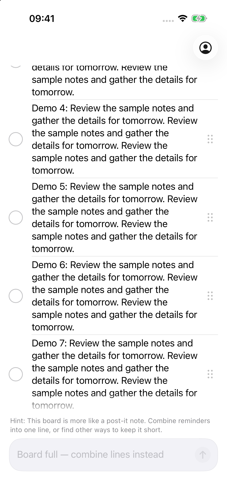
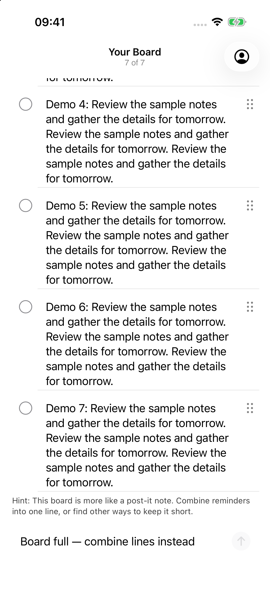
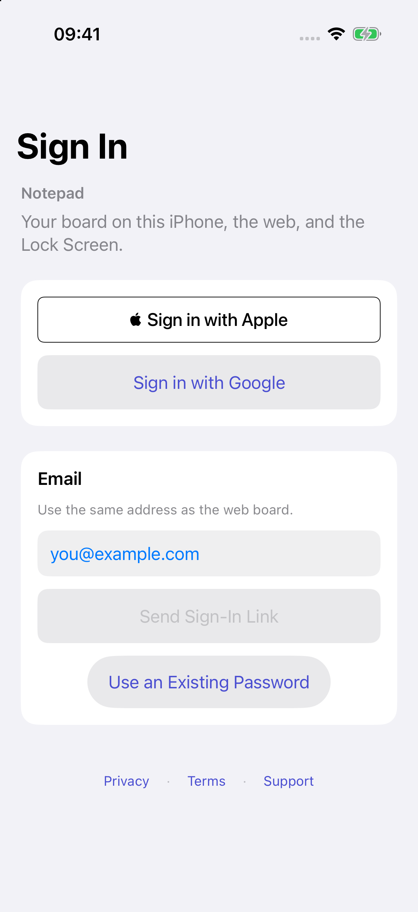
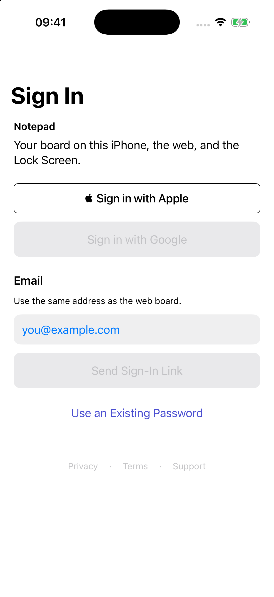
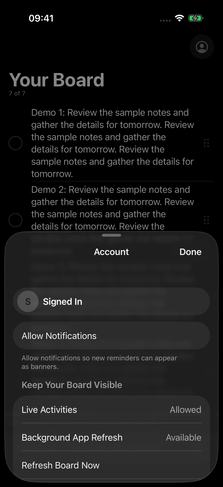
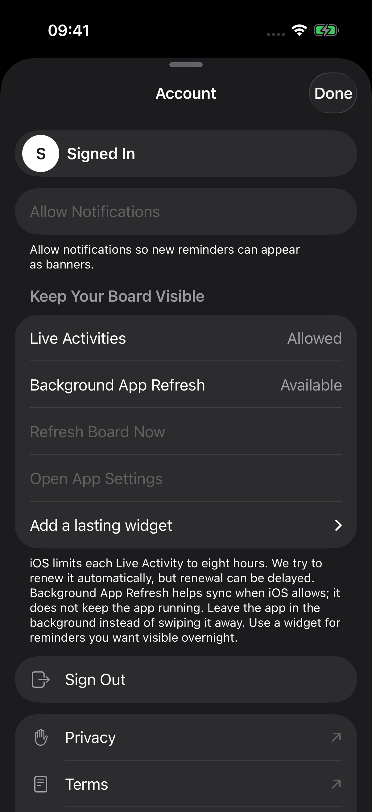
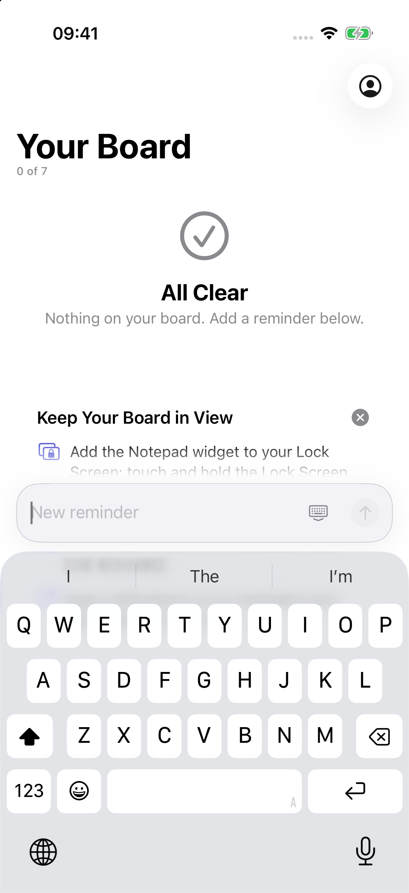
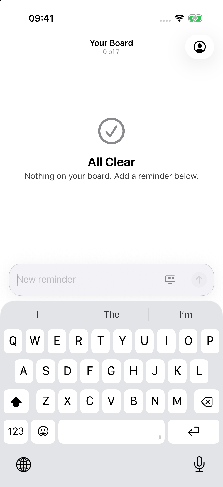

# Notepad UI hill climb: progress report

Work continues on `hillclimb/ui`. Round 6 Codex grades are **Sol 8.83** and **Astra 8.92**, with minima **7.8/8.0**. Both identify remaining crowding. Round 6 Opus is deferred until the density fixes to conserve Claude tokens; its latest completed round 5 score is **8.69**, minimum **7.8**. The final all-three >=9/minimum7 gate remains unmet.

## Category scores

| Category | R1 Sol | R6 Sol | R1 Astra | R6 Astra | R3 Opus | R5 Opus |
| --- | ---: | ---: | ---: | ---: | ---: | ---: |
| Visual hierarchy | 7.5 | 8 | 7 | 8.3 | 8.5 | 8.9 |
| Spacing/grid | 7.0 | 8 | 7 | 8.2 | 8.3 | 8.8 |
| Typography scale | 8.5 | 9.1 | 8 | 8.9 | 8.2 | 8.8 |
| Dynamic Type | 7.5 | 9 | 7 | 9.3 | 8.6 | 8.8 |
| Light contrast | 7.0 | 9.4 | 7 | 9.3 | 8.4 | 8.9 |
| Dark contrast | 6.5 | 9.4 | 6.5 | 9.3 | 8.0 | 8.9 |
| Iconography | 8.0 | 9.3 | 8 | 9.2 | 8.6 | 8.8 |
| Safe area / Dynamic Island | 8.0 | 9.2 | 8 | 9.3 | 8.8 | 8.9 |
| Scroll/pull-down / last row | 4.0 | 9.4 | 4 | 9.5 | 8.4 | 8.9 |
| List rows | 6.5 | 8.7 | 6.5 | 8.9 | 7.8 | 8.9 |
| Empty states | 7.0 | 8.4 | 7.5 | 8.8 | 8.8 | 8.9 |
| Composer ergonomics | 6.0 | 9.1 | 6 | 9.1 | 8.6 | 8.7 |
| Keyboard handling | 7.0 | 9.2 | 7.5 | 9.3 | 8.5 | 8.8 |
| Sheet presentation/detents | 7.0 | 9.1 | 6 | 9.3 | 8.5 | 8.7 |
| Navigation clarity | 7.5 | 9.1 | 7 | 9.2 | 8.7 | 8.9 |
| Touch targets | 4.5 | 9.4 | 4.5 | 9.5 | 8.4 | 9.1 |
| Haptics | 7.0 | 8.2 | 7 | 8.2 | 7.5 | 7.8 |
| Animation/transitions | 6.5 | 8.5 | 6.5 | 8.7 | 7.6 | 8.2 |
| Loading states | 7.5 | 9.2 | 7 | 9.2 | 8.5 | 8.7 |
| Error states | 7.5 | 9.2 | 7 | 9 | 7.6 | 8.7 |
| VoiceOver/labels | 7.5 | 8.9 | 7.5 | 8.8 | 8.2 | 8.6 |
| iOS HIG consistency | 7.5 | 8.8 | 7 | 9 | 8.1 | 8.8 |
| Lock Screen / Live Activity | 6.0 | 8.9 | 6 | 8.8 | 7.8 | 8.1 |
| Sign-in/onboarding | 6.5 | 8.4 | 6.5 | 8.5 | 8.0 | 8.8 |
| Settings/account | 7.0 | 7.8 | 6 | 8 | 8.1 | 8.7 |
| Performance feel | 6.5 | 8.3 | 6.5 | 8.2 | 7.6 | 7.9 |
| Delight | 6.5 | 8 | 6.5 | 8.4 | 7.8 | 8.1 |
| Long text | 7.0 | 8.4 | 7 | 9 | 8.7 | 8.8 |
| Reduced Motion / Transparency | 7.0 | 9.2 | 6 | 9.3 | 8.0 | 8.7 |
| Palette / minimalism | 7.0 | 9.3 | 7 | 9 | 9.0 | 9.1 |

Start/current category comparisons are shown above. Full intervening-round histories remain in their score reports. [Round4 machine-readable scores](rounds/4/scores.json).

## Current verification

Frozen production/test source: `b5d9bb3`. Round 4 passed **285/285 tests**: 263 unit and 22 UI, zero failures/skips. Fresh unsigned arm64 Debug/Release builds, 23 iOS Python checks and 52+4 offline Deno tests passed. All eight normal-settings keyboard cases completed their scrolling, clearance and edge-tap checks. Zero observed runtime warnings and invalid-frame events; other diagnostics remain retained. [Validation](validation/round4/README.md).

The original round 3 275-pass/1-failure run stays intact. A test-only correction handled supported interactive keyboard dismissal and refocus; its subsequent 276-test recheck and three repeated keyboard matrices passed. No original geometry or edge-tap assertion was disabled.

## Screenshots and Apple references

Round1 has18 native baseline images; round2 has48; round3 has110 (102 original plus8 post-scroll keyboard rechecks); round4 has288. Every grading image has device/source/hash provenance on the original regular iPhone17Pro/iOS26.2. Round3 adds8 actual XXXL Apple Reminders references for list, bottom, compose and Details in both appearances. Pairings exclude rejected transition frames and disclose imperfect matches. Notes, Apple sign-in and exact Activity equivalents remain unavailable. [Round4 inventory](rounds/4/inventory.json) · [Reference pairings](rounds/4/pairings.md).

| State | Before: round1 | Current: round4 |
| --- | --- | --- |
| Final row after pull |  |  |
| Sign-in surfaces |  |  |
| Account initial sheet |  |  |
| Composer keyboard |  |  |

Native Activity has no round1 native baseline, so no baseline pair is invented. Expanded Island evidence uses unmodified recording frames; Notification Center banners do not certify actual locked-device geometry. Unit-rendered attachments are separate from native captures.

## Merged changes

- Capture harness: repeatable offline demo fixtures, geometry/pixel checks, screenshot scripts, Apple-reference pairings and score validator.
- Board reading (`cc98098`, `ef82a67`): removed final-ink fades, fixed refresh cleanup and compact title behavior, measured44pt controls.
- Activity polish (`dcc4200`): scalable type, native surface budgets and lower-corner footer clearance.
- Sign-in surfaces (`04098b7`): flat outer surfaces,44pt field focus containers and keyboard scrolling.
- Account (`9f94f55`): opaque grouped sheet, large on open/reopen, medium retained, accessible Done and safe demo scrolling.
- Activity overflow (`970f567`, `3020d31`): preserves original line totals across payload/surface caps; five visible+five hidden becomes three visible+seven hidden. Optional metadata retains legacy lines encoding. Backend preparation is committed but undeployed; previously summarized remote payloads cannot recover lost totals.
- Keyboard recovery (`3993113`): replaces invalid-frame keyboard-toolbar path with a layout-participating48pt Done inset, separated alternate action, safe local demo editing, exact-text error announcement deduplication.
- Board multiline (`d9fa416`, `8e384d0`, `1add78a`): first-line control alignment, semantic contrast, intrinsic-height static capacity copy, flat guide hidden during composing, exact-text error announcements and44pt retry.
- Test correction (`542b9f7`): confines form scrolling above the keyboard and verifies dismissal/refocus before geometry checks.

Individual task counts and retained intermediate failures are in [task evidence](tasks). Current integrated **293-test pass** supersedes worker-only totals. All merges stay on `hillclimb/ui`; main, deployment, uploads and force pushes remain untouched. Existing user untracked files are preserved.

## Remaining limits

True device locking, physical cutout geometry, arbitrary wallpapers, tactile haptics, spoken VoiceOver, accessibility sizes beyond XXXL and measured motion/performance remain unverified. The actual Reduce Motion/Reduce Transparency/Increase Contrast combination now passes the tested default/XXXL keyboard and contrast cases; other combinations are not certified. Source/tests support only the claims recorded with them. Current-session quota metadata reports 17% used in the 10080-minute weekly window; [snapshot](rounds/5/usage.json). No plateau decision before fresh grades.

## Install on a phone

1. Check out `hillclimb/ui`. Generate `ios/LazyMansReminders.xcodeproj` using the existing XcodeGen workflow and your private development `Config.xcconfig`.
2. In Xcode select your development team and a connected, trusted iPhone with Developer Mode enabled. Select the app scheme, then Build and Run.
3. Use the normal account build for real sign-in/notifications. Screenshot setup uses the isolated `systems.edmundlim.NotepadHillclimb` demo bundle/group; its offline data is synthetic.

No App Store/TestFlight upload or deployment is authorized. Physical sign-in, persistence, notifications and haptics need phone verification.

Written by gpt-6.1-sol in Codex on behalf of Edmund

Next batch: board intentional completion/Done/contrast, sign-in dark Apple control and spacing, Account typography/alignment/error announcements. Existing wording stays fixed by Edmund’s explicit 2026-11-05 decision: “Keep existing wording.”

## Latest integrated improvements

- Sign-in: visible native white-outline Apple button, readable help text and a 48pt Done inset with 8pt less padding. The toolbar path that produced invalid frames remains replaced. Enabled-looking provider captures are inert fixtures.
- Board: completion only on the 44pt circle, Done for nonempty drafts with text retained, unboxed readable capacity status, and populated-error retry using existing labels and full diagnostic text.
- Account: body-sized disclosure label, aligned delete-row icon/title, readable helper/footer text and exact-message error announcement deduplication. Enabled-style fixtures permit local disclosure/recovery while blocking real account and external actions.

All three branches are merged. Their individual tests and affected captures are recorded under `tasks/`; current combined acceptance uses the fresh 285-test round 4 run.

## Round 4 coverage and remaining findings

The packet contains 288 verified native PNGs, seven recordings and 17 Apple Reminders references. Selected actual-system Reduce Motion, Reduce Transparency and Increase Contrast states were captured, and the original Off settings restored. The combined-settings recording shows the alternate sign-in action, but one settled viewport omits it; a complete clearance matrix remains unproven. This is not a diagnosis of unreachability.

Top-edge fragments remain observed. New reviewer measurements find normal-size red error-message text below 4.5:1 in sign-in and Account; the existing helper/footer contrast checks excluded semantic error red. No passing error-message contrast gate is claimed. Independent Codex grades are complete. Opus8.51 confirms the loop continues; no final success is claimed.

Written by gpt-6.1-sol in Codex on behalf of Edmund

Round4 all-three reviews validate; final gate is false. Next work covers board edge/VoiceOver polish, informational text contrast, combined-settings keyboard reproduction and safe Activity readability investigation. Existing copy stays fixed.

## Activity readability experiment

Candidate6a563b1 passed289 tests and native count/corner checks, but its word-boundary rendering removed a previously fitting final word without adding visible content. The parent kept the current renderer. Twelve native image hashes verified; candidate source/tests and provenance are retained as an experiment. No density or launch-performance improvement is claimed. [Experiment and decision](tasks/activity-readability/README.md).

Written by gpt-6.1-sol in Codex on behalf of Edmund

## Error contrast and accessibility keyboard follow-up

K source2e6aa8c/evidence41c2027 merged. Existing error text and destructive Account label use readable primary ink, and the inert enabled sign-in fixture now renders legal links normally while discarding demo URLs.291worker tests and44nativecontrastgates passed (minimum12.06:1); all8normal and8actualcombined-settingskeyboardcases passed.123acceptednativeimagehashesverified. No production keyboard change was needed.

The worker restored incidental Auto-Play Message Effects drift manually. Parent added a test-only teardown correction to remember/restore it; that newer test revision still requires the upcoming integrated runtime validation. Board-edge work remains active. [Evidence](tasks/error-keyboard/README.md).

Written by gpt-6.1-sol in Codex on behalf of Edmund

## Board edge and accessibility follow-up accepted

L0265cb4/evidence46e6b4f merged: top-only softening during departed-content scrolling, an opaque accessibility-settings edge, one reminder reading stop and primary loading/error text.287worker tests passed;144finalnativeimagehashes verified. Bottom-row geometry/ink remains intact. Native binding alone was ineffective; the top-only mask is the actual treatment.

The separate Motion restoration attempt built but ran0tests because manual device references failed. No setting changed; its value instrumentation and failures are retained. Combined K+L round5 validation must execute the restoration proofs and expected293tests before grading. [Board evidence](tasks/board-edge-accessibility/README.md) · [Unrun restoration attempt](tasks/motion-cleanup-recheck/README.md).

Written by gpt-6.1-sol in Codex on behalf of Edmund

## Round 5 validation

Combined K+L source is verified at `c60288dae3173383442723e70f7874b8878d891d`: **293/293 tests passed** (263 unit, 30 UI), including every prior baseline ID. Both actual Settings methods restored all four original values at each teardown. Fresh Debug/Release, Python 23 and Deno 52+4 passed. Parent verified all 394 native images and paired reference hashes, plus integrated production/test/backend hashes. Seven recordings remain transition evidence; no launch metric was measured.

The full-device combined-settings supplements show complete keyboards where XCTest protected-image captures are partial. Native top-edge, final-row ink, contrast and accessibility-tree checks passed; speech and physical sensation remain unobserved. The simulator was returned running with its original settings, light/Large and no owned Activity. [Evidence and limitations](validation/round5/README.md). Independent round 5 grades are running; latest completed scores remain round 4.

Edmund confirmed “Keep existing wording.” The raw network-error text is intentionally retained and the copy question is closed.

Round 5 independent Codex reports validate at **9.06 / 9.15**, both above the target and with no category below 7. Opus 5.5/medium now reviews this same packet; no final all-three success is claimed.

Round 5 Opus completed at **8.69/minimum 7.8**. All reports validate; final success is not reached. Round 6 targets the remaining native chrome, capacity affordance and constrained-surface reading findings. Raw network-error copy is a closed product decision.

## Round 6 Island readability

Accepted native Island-only text tightening (`9b3aea1`): the XXXL sample ending now reads “sample notes.” while the first row stays complete. Type size, native line budgets, counts and corner/footer margins remain intact. All 293 worker tests pass; parent verified 30 native image/reference hashes and inspected the originals. Very long lines still use native tail truncation.

[Before](tasks/activity-tightening/before/multiline-dark-XXXL-expanded.png) · [After](tasks/activity-tightening/after/multiline-dark-XXXL-expanded.png) · [Evidence and limits](tasks/activity-tightening/README.md). No new score is inferred before the full round 6 capture and review.

## Round 6 capacity presentation

The full-board status now uses the width previously occupied by a disabled send arrow (`7c2793a`). The arrow returns below capacity. Exact copy and scaled typography are preserved; XXXL can fit the full status on one line. **297 worker tests pass**, including four new native state/geometry/ink/interaction cases and all prior 293 IDs. Parent verified all 16 final capture/reference hashes.

[XXXL full-board bottom](tasks/board-capacity/accepted-captures/capacity-dark-XXXL-bottom-after-pull.png) · [Returned composer](tasks/board-capacity/accepted-captures/capacity-dark-XXXL-normal-composer-draft.png) · [Evidence](tasks/board-capacity/README.md). Combined round 6 verification follows the remaining sign-in and Account handoffs.

## Round 6 sign-in chrome

Sign-in now keeps the existing Password label visible with a nonempty secure value and gives the native field a 48pt frame (`e22a84a`). The native iOS 26 hard top edge reduces departing-content ghosting in the measured title bands. Legal links are reachable after scrolling and clear the native safe bottom by at least 18.33pt; no extra padding was needed. The earlier single Apple loading-label omission did not reproduce in 36 settled samples.

**297 worker tests pass**, including four new methods and the unchanged normal/combined keyboard matrix. Parent verified 72 image/reference hashes. [Populated keyboard](tasks/signin-chrome/final-native-dark-XXXL-focused.png) · [Footer reached by scrolling](tasks/signin-chrome/final-native-light-XXXL-bottom.png) · [Evidence and limits](tasks/signin-chrome/README.md). The full integrated source still requires round 6 verification and grading after the Account handoff.

## Round 6 Account chrome and guidance

Account’s native hard top edge clears departing text beside the title. The existing persistence guidance is split at a sentence boundary into two paragraphs with 6pt spacing; all words are preserved and measured contrast is at least 17.01:1. Done uses a 46pt local frame to retain at least 44.2pt on-screen in the scaled medium sheet. **296 worker tests pass** with all 293 prior IDs; parent verified all 60 native image/reference hashes.

[Readable XXXL guidance](tasks/account-chrome/manual-dark-XXXL-centered.png) · [Evidence](tasks/account-chrome/README.md). N, O, P and Q are integrated; fresh combined round 6 validation, measurements and grading remain required. No final success is claimed.

## Round 6 combined evidence, pending footer recheck

**307/307 tests pass**, retaining all304 prior IDs, with per-method four-setting restoration and fresh Debug/Release/Python23/Deno52+4. Parent verified537 native PNG/reference pairs; these include repeated samples. Five public simulator Debug samples establish launch mean1.0319s, scroll clock4.6921s and scroll signpost duration2.3505s. They do not establish hardware feel, frame pacing or a before/after improvement.

One extra required gesture check failed on the deliberately noninteractive enabled-appearance fixture. Its root has hit testing disabled. The historical failure remains intact; a focused recheck must prove actual footer gestures on the gesture-enabled fixture before required gates can be accepted. [Exact failure](validation/round6/parent-findings.md) · [Full evidence and metric samples](validation/round6/README.md). Crowding remains an explicit user priority for the next design pass.

## Round 6 gesture proof accepted

The new focused method proves allfour real-gesture variants: XXXL content moves127pt and the footer clears the safe bottom by50.33pt. **308/308 tests pass**, retaining all307prior IDs, with per-method restoration. No production change was needed. Historicalfailure/provenance remain intact; required checks now pair actualordinarygestures with separate enabled-appearance geometry/inertness.

[Proof and retained limitations](validation/round6/recheck/README.md). Both Codex/high reviews are running against the same537historical+20supplemental native images and byte-identical production source. They explicitly audit the crowding Edmund flagged; no final acceptance or new score is claimed.

Round 6 Codex density audits validate at **8.83 / 8.92**. Account guidance/action hierarchy, sign-in field grouping and full-capacity status/help alignment drive the next three isolated tasks. Safety checks remain passing; visual crowding remains unresolved. [Sol review](rounds/6/scores-gpt-6.1-sol.md) · [Astra review](rounds/6/scores-gpt-6-astra.md).

## Density candidates awaiting serialized validation

Account R demonstrates larger section gaps and quieter readable guidance; board T places status before its aligned hint and saves16pt. Their dedicated native checks pass, but full suites retain failures. **Neither candidate app change is merged.** Evidence and frozen source patches are retained for review/recheck. R passed308/310; T passed308/312, with no skips. No new scores or final acceptance are claimed.

The circle target’s43.99999999999994pt representation is handled by a1e-9pt test comparison allowance; that test-only correction still requires runtime validation. Other timeouts/terminations remain unresolved. Serialized rechecks follow the current sign-in suite, and the login’s overall composition remains the visual priority.
