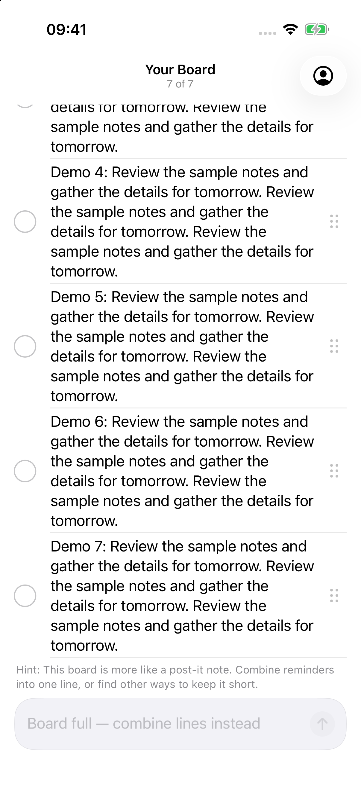
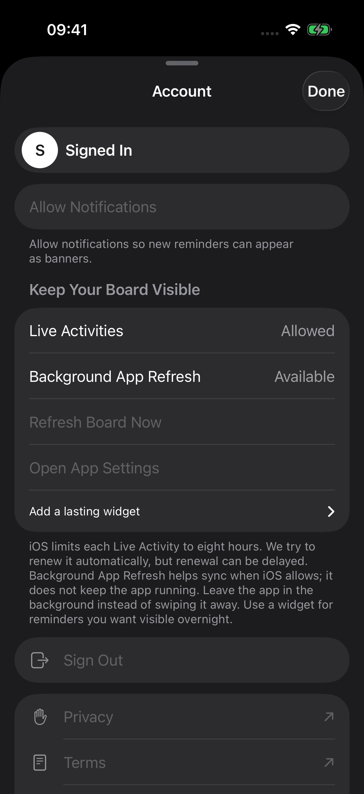
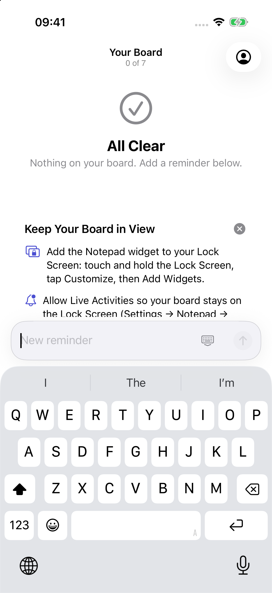

# Notepad UI hill climb: progress report

Work continues on hillclimb/ui. Final score gate is not reached. Round1 is the actual screenshot baseline: Sol6.88 and Astra6.70 over30 categories. Opus has not run; it is eligible only after BOTH Codex graders score >=8.5 overall in the same round. Final stop remains all three >=9 with every category >=7.

## Category scores

| Category | Round1 Sol | Round1 Astra | After integrated batch |
| --- | ---: | ---: | --- |
| Visual hierarchy | 7.5 | 7 | Pending |
| Spacing/grid | 7 | 7 | Pending |
| Typography scale | 8.5 | 8 | Pending |
| Dynamic Type | 7.5 | 7 | Pending |
| Light contrast | 7 | 7 | Pending |
| Dark contrast | 6.5 | 6.5 | Pending |
| Iconography | 8 | 8 | Pending |
| Safe area / Dynamic Island | 8 | 8 | Pending |
| Scroll/pull-down / last row | 4 | 4 | Pending |
| List rows | 6.5 | 6.5 | Pending |
| Empty states | 7 | 7.5 | Pending |
| Composer ergonomics | 6 | 6 | Pending |
| Keyboard handling | 7 | 7.5 | Pending |
| Sheet presentation/detents | 7 | 6 | Pending |
| Navigation clarity | 7.5 | 7 | Pending |
| Touch targets | 4.5 | 4.5 | Pending |
| Haptics | 7 | 7 | Pending |
| Animation/transitions | 6.5 | 6.5 | Pending |
| Loading states | 7.5 | 7 | Pending |
| Error states | 7.5 | 7 | Pending |
| VoiceOver/labels | 7.5 | 7.5 | Pending |
| iOS HIG consistency | 7.5 | 7 | Pending |
| Lock Screen / Live Activity | 6 | 6 | Pending |
| Sign-in/onboarding | 6.5 | 6.5 | Pending |
| Settings/account | 7 | 6 | Pending |
| Performance feel | 6.5 | 6.5 | Pending |
| Delight | 6.5 | 6.5 | Pending |
| Long text | 7 | 7 | Pending |
| Reduced Motion / Transparency | 7 | 6 | Pending |
| Palette / minimalism | 7 | 7 | Pending |

Round2 combined validation executed261 tests (249 unit+12 UI), all passed with no skips.48 fresh native images and4 new settled Reminders references are merged; both new Codex ratings are in progress. No after score is inferred from tests.

## Screenshot evidence and comparisons

Round1 contains18 real1206x2622 screenshots in light/dark, including full/empty boards, composer, account, sign-in, long text, XXXL and bottom-after-pull. Its manifest retains a failed synthesized scroll attempt and the successful advised raw-drag recovery. Five usable Apple Reminders references are paired in rounds/1/pairs.json; Notes is unavailable in this runtime and four transitional Reminders captures are excluded. The pairs below use matching actual app states from round1 and round2 on the original17 simulator.

- [Baseline final row](rounds/1/full-light-default-bottom-after-pull.png): geometrically contained, but final ink fades beneath chrome.
- [Baseline XXXL final row](rounds/1/long-text-light-XXXL-bottom-after-pull.png).
- [Native Island after candidate fix](tasks/activity-polish/long-dark-XXXL-expanded.png): actual native recording frame, clear footer and rounded-corner clearance.
- [Native Activity banner after candidate fix](tasks/activity-polish/long-light-XXXL-notification-center.png): Notification Center, not a truly locked-device capture.

Activity task retained an intermediate candidate clipping image and recording; these are not baseline round1 evidence. See its task report and manifest for exact source/operation provenance. Unit-rendered Activity images are explicitly separate from native surface captures.

## Merged changes and verification

- Integration created from origin/main5fc4cbc; original untracked files preserved. All work stays off main and no deploy/submission/force-push occurred.
- Capture/rating infrastructure: offline isolated Debug fixtures, actual frame/height probes, repeatable capture script, reference-pair manifest and score validator. Existing247 XCTest tests passed on regular17; repaired offline fixture UI test1/1 passed. Baseline measured field22pt/Account36pt failures and a pull-idle timeout remain recorded until board fixes pass.
- Activity task dcc4200/de1ad3a: scalable typography, independent surface line budgets, native Island lower-corner clearance and existing overflow wording. Board capacity/storage/schema unchanged. Build and249 unit tests passed; native Island check1/1 at default and1/1 at XXXL. Parent inspected representative native images and verified24 capture hashes before merging.
- Board task cc98098/ef82a67/9ff1d6c merged: final-line fades removed, refresh cleanup and compact native context,44pt measured controls;253 tests passed on its branch (247 unit +6 UI), with3 additional fresh-process pull repetitions and20 verified captures. Worker evidence is supplemented by the now-passing combined suite. Sign-in04098b7/96077a3 also merged: flattened outer surfaces,44pt focus containers and keyboard scrolling;250 tests passed (247 unit+3 UI),24 settled captures verified. One invalid-frame runtime warning remains localized to the keyboard-matrix test, and the XXXL floating Done can overlap a lower secondary action; both remain explicit review concerns. Account9f94f55 merged: opaque grouped sheet, large initial/reopened detent with medium retained, safe demo scrolling/Done;249 unit+2 Account UI tests passed,16 captures verified. All four scopes are merged; combined261-test validation and round2 capture are complete, with fresh ratings in progress. Combined source8dbf6a8 now has261 passing tests and48 actual images; a fresh parent arm64 Release build also succeeded. Existing compiler warnings and the sign-in runtime warning remain documented.

## Remaining limits

Actual device locking is unavailable through the simulator interface; Native Notification Center banner plus expanded Island recording evidence are available. Arbitrary wallpaper contrast, physical haptics and true hardware Island behavior remain unverified. Notes references remain unavailable. No dedicated quota tool was found; current-session rate-limit metadata now reports6% used in the weekly window (timestamped in rounds/2/usage.json). Stop on actual near-limit indication if available; do not wait into the next weekly window.

## Install on a phone

After final integrated verification, use hillclimb/ui, generate ios/LazyMansReminders.xcodeproj with the existing XcodeGen workflow and your existing private Config.xcconfig/development signing team. Select a connected trusted iPhone in Xcode and Build and Run. The screenshot configuration uses an isolated demo bundle/group and is not the normal account build. No upload, App Store or TestFlight step is authorized. Physical sign-in, notifications, persistence and haptics require phone validation.

Written by gpt-6.1-sol in Codex on behalf of Edmund

## Before/after pairs: round1 to round2

| State | Before | After integrated batch |
| --- | --- | --- |
|Final row after pull|||
|Sign-in surfaces|||
|Account initial sheet|||
|Composer keyboard|||

Native Activity has fresh integrated round2 evidence; no round1 native baseline existed, so no baseline pair is invented. Current numeric after scores remain pending independent reviewers.
